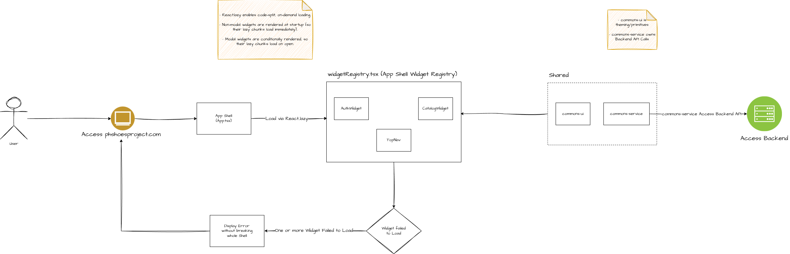
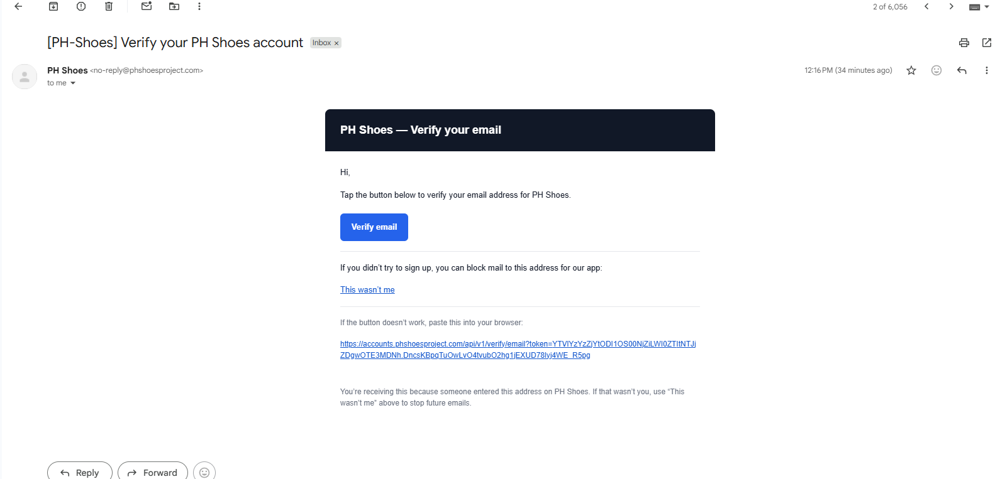
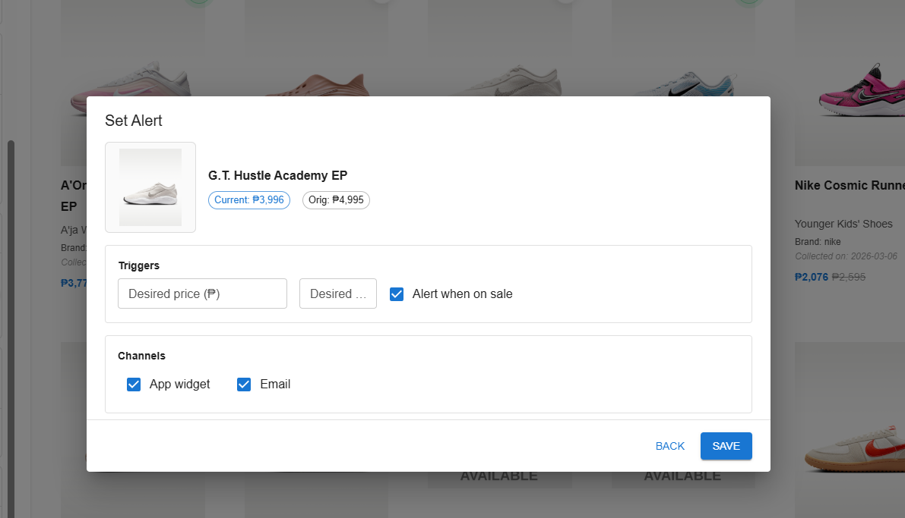
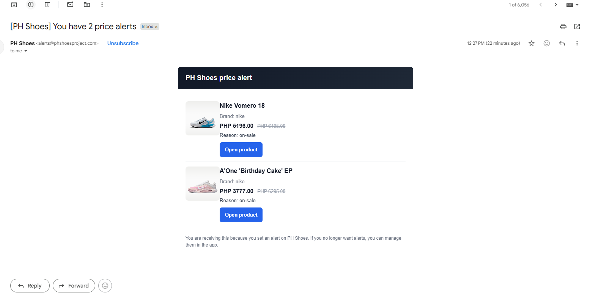
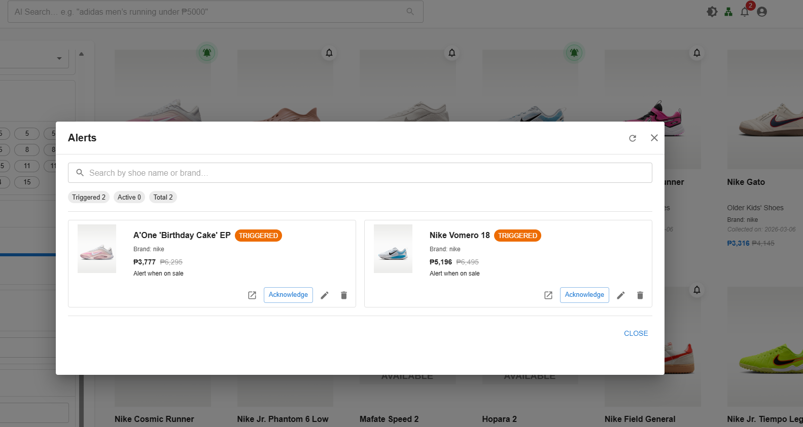

# PH Shoes Data SPA

User-facing Single Page Application for shoe discovery, account verification, and alert-driven notifications.
It consumes curated catalog data and keeps UI concerns separated from backend services.

## Frontend Architecture

Detailed architecture document: [`docs/ph-shoes-data-spa-frontend-architecture.md`](./docs/ph-shoes-data-spa-frontend-architecture.md)

High-level design:
- App shell: `apps/web/src/App.tsx`
- Widget registration + lazy loading: `apps/web/src/shell/widgetRegistry.tsx`
- Shared domain/services (auth, search, alerts): `packages/commons-service`
- Shared UI primitives: `packages/commons-ui`
- Widget runtime contract: `packages/widget-runtime`
- Feature widgets: `packages/widgets/*`

Architecture visual:

## Usage

### End-to-End Flow
`Sign up -> Verify email -> Browse items -> Set alert -> Get notified -> View triggered alert`

### General Usage
This walkthrough covers the full user journey from onboarding through alert handling.

- [Public usage video](https://drive.google.com/file/d/1TD2_m9Pzc_1WvUzs19qvHAE87fmcgUeT/view?usp=sharing)
- What this demonstrates: Core navigation, browsing, alert setup, and triggered notifications.

### User Verification
After signup, the user verifies their email before accessing personalized alert features and continuing to item browsing.

- What this demonstrates: Email ownership validation as an account activation gate.

### Browse Items
After verification, users browse available shoe listings and inspect details before configuring alerts.

- What this demonstrates: Discovery and evaluation stage between onboarding and alert creation.

### Set Alert
Users define alert criteria based on preferred search filters and catalog preferences.

- What this demonstrates: User-defined alert rules that control when notifications are sent.

### User Notified
When a tracked item matches configured criteria, the user receives a notification.

- What this demonstrates: Notification delivery once business rules are satisfied.

### Alert Triggered
This state shows a successful alert trigger for matching catalog updates.

- What this demonstrates: Final step in the alert lifecycle from setup to actionable outcome.

### Troubleshooting
- Verification email not received: Check spam/junk, verify signup address, then retry after a short wait.
- Verification link expired or invalid: Request a new verification email and use only the latest link.
- Alerts not triggering: Validate filter criteria against active catalog data and confirm notification settings are enabled.
- Notification not visible: Refresh session and confirm the account is verified and logged into the correct profile.

## Local Development

Prerequisites:
- Node.js LTS
- npm

Run locally:
1. `npm install`
2. `npm run dev`

## Environment Configuration

Set `VITE_*` variables in `apps/web/.env` for:
- Catalog API endpoint
- User accounts API endpoint
- Alerts API endpoint
- Text search API endpoint

## Documentation

- [`docs/ph-shoes-data-spa-frontend-architecture.md`](./docs/ph-shoes-data-spa-frontend-architecture.md) - Frontend modules, data flow, and interaction boundaries.
- [`docs/developer-notes.md`](./docs/developer-notes.md) - Practical implementation notes for widget usage, hooks, and TypeScript patterns.

## Related Repositories

- [PH Shoes Extraction Automation](https://github.com/nimbly-dev/ph-shoes-extraction-automation)
- [PH Shoes DBT Analytics](https://github.com/nimbly-dev/ph-shoes-dbt-analytics)
- [PH Shoes Data SPA](https://github.com/nimbly-dev/ph-shoes-data-spa)
